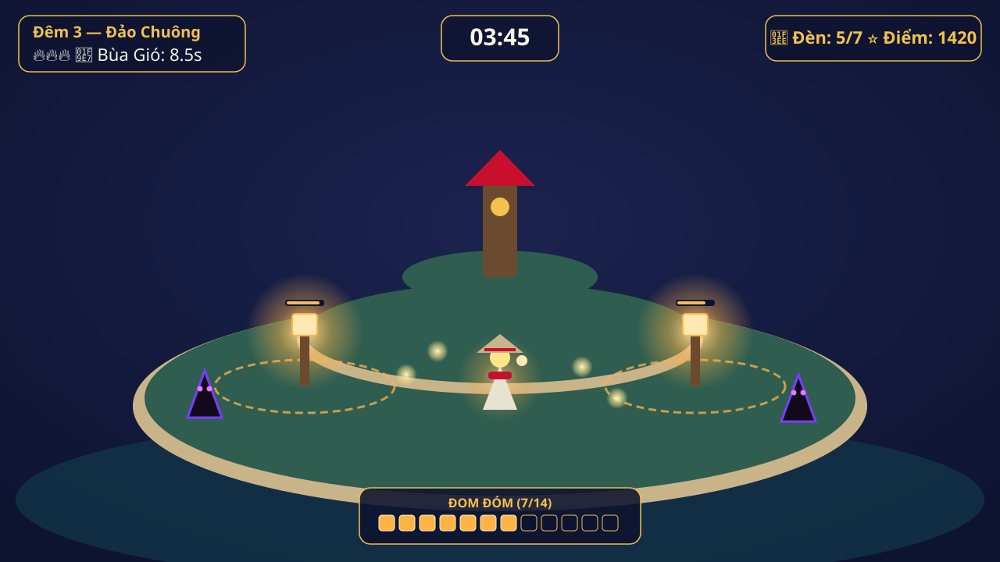

# 🏮 Đảo Đèn Lồng v1.0.0 — Day 12 AI SDLC Lab

> 🎬 **Video Demo (`.mp4` < 5 phút):** [Xem Video Demo trên GitHub Release `v1.0.0`](https://github.com/ThinhTran-codee/K5-L3-LAB-Day12-AI-SDLC/releases/tag/v1.0.0) *(hoặc tại `docs/demo/demo.mp4`)*
> 📊 **Báo cáo Bằng chứng Kiểm chứng (Phase 1 → 4):**
> - **Phase 4 (`v1.3` — Benchmark, Soak Test, Leaderboard, Accessibility):** [docs/proof/phase-4/VERIFICATION_REPORT.md](docs/proof/phase-4/VERIFICATION_REPORT.md) · [bench.json](bench.json) · [soak.json](soak.json)
> - **Phase 3 (`v1.2` — Change Request "Đèn cạn dầu"):** [docs/proof/phase-3/VERIFICATION_REPORT.md](docs/proof/phase-3/VERIFICATION_REPORT.md) · [ADR-001](docs/notes/ADR-001-phase3-fuel-and-dawn-survival.md)
> - **Phase 2 (`v1.1` — Ba Hòn Đảo):** [docs/proof/phase-2/VERIFICATION_REPORT.md](docs/proof/phase-2/VERIFICATION_REPORT.md) · [Spec Phase 2](docs/notes/phase-2-spec.md)
> - **Phase 1 (`v1.0` — PRD-0):** [docs/proof/phase-1/VERIFICATION_REPORT.md](docs/proof/phase-1/VERIFICATION_REPORT.md) · [Spec Phase 1](docs/notes/phase-1-spec.md)
> - **Retrospective & Nhật ký dùng AI / Token:** [docs/notes/RETROSPECTIVE.md](docs/notes/RETROSPECTIVE.md) · [docs/notes/ai-log.md](docs/notes/ai-log.md) · [CHANGELOG.md](CHANGELOG.md)



---

## 1. Mô tả ngắn

**Đảo Đèn Lồng** là game 3D góc nhìn thứ ba kết hợp bộ mô phỏng tất định 60Hz (deterministic headless simulation) tuân thủ **Test Contract v1.3**. Người chơi điều khiển **Mây** — người giữ đèn nhỏ tuổi đội nón lá có treo chiếc đèn lồng nhỏ — vượt qua **3 Đêm trên Ba Hòn Đảo** (**Đêm 1: Đảo Bến**, **Đêm 2: Đảo Cau**, **Đêm 3: Đảo Chuông**) để thu thập đom đóm, thắp sáng và châm dầu bảo vệ các **Đèn Lồng Lớn** trước **Bóng Mực hút dầu (`drain`)** cùng **Gió Lạc**, giữ cho ít nhất `60%` số đèn trên đảo sáng tới khoảnh khắc **Bình Minh (`dawn_survived`)**.

---

## 2. Yêu cầu hệ thống & Cài đặt / Chạy Game (Tối đa 3 lệnh)

- **Yêu cầu hệ thống:** **Node.js >= 18** (chạy trực tiếp trên **macOS, Linux và Windows**; trình duyệt hỗ trợ WebGL2 cho giao diện 3D; chế độ Headless/Benchmark/Soak chạy thuần CLI không cần GPU rời).

```bash
npm install && npm run build
npm test
npm start
```

- Sau khi chạy `npm start` (hoặc `node src/run.js`), mở trình duyệt tại **`http://localhost:5173`** để chơi ngay bản phát hành `v1.0.0`.
- *(Tùy chọn Docker)*: `docker build -t dao-den-long . && docker run -p 5173:5173 dao-den-long`

---

## 3. Điều khiển (Controls — Hỗ trợ Đổi phím & Phát hiện trùng phím)

Mọi phím dưới đây đều có thể đổi và lưu lại trong mục **⚙️ Cài đặt & Dễ tiếp cận**:

| Phím mặc định | Hành động trong game |
|---|---|
| `W A S D` (hoặc `↑ ↓ ← →`) | Di chuyển Mây (`6.0 m/s`, hoặc `7.2 m/s` khi có Bùa Gió) |
| `Space` | Nhảy (`Jump`: `vy = 7.0 m/s`, trọng lực `-20 m/s²`) |
| `Shift` (hoặc `L`) | **Lướt (`Dash`)**: `14 m/s` trong `0.2 s` (`12` ticks), giữ độ cao trên không, hồi chiêu `1.5 s` (`0 s` khi có Bùa Gió) |
| `E` | **Thắp đèn / Thắp lại / Châm dầu (`Interact`)**: trong bán kính `2.0 m` quanh đèn chưa sáng (`10` đom đóm lần đầu, `5` đom đóm khi thắp lại) hoặc đèn đang sáng chưa đầy dầu (`fuel < 100`) |
| `F` (hoặc `K`) | **Tỏa Sáng (`Pulse`)**: tốn `3` đom đóm, bán kính 3D `5.0 m`, làm choáng Bóng Mực `120` ticks (`+15` điểm nếu đang `drain`, `+5` điểm nếu bình thường) |
| `Esc` hoặc `P` | **Tạm dừng (`Pause`)**: mở menu Tiếp tục / Chơi lại / Bảng Xếp Hạng / Cài đặt & Đổi phím / Về Menu |
| `Q` hoặc `Kéo chuột` | Xoay góc nhìn Camera 3D quanh Mây |
| `G` | *(Sáng tạo)* Rung Chuông Gió triệu hồi dải hạt sáng dẫn đường tới Đèn Lồng cần chú ý gần nhất |

---

## 4. Cách chạy Kiểm thử, Headless, Benchmark, Soak Test & Xuất Bảng Xếp Hạng

Toàn bộ lệnh chuẩn theo [game.contract.json](game.contract.json) (`contract_version: "1.3"`):

1. **Chạy toàn bộ 13 bộ Unit, Regression & Contract v1.3 Tests:**
   ```bash
   npm test
   ```
2. **Chạy chế độ Headless (`headless_cmd`):**
   ```bash
   node src/headless.js --seed 42 --night 1 --ticks 600 --out out.jsonl --snapshot-every 10
   ```
3. **Chạy chế độ Benchmark 30 giây (`bench_cmd`):**
   *(Lưu ý về VSync: Trong chế độ CLI `src/bench.js`, vòng lặp khung hình dùng `setImmediate` không khóa VSync (`vsync_off: true`); khi mở trong trình duyệt web thông thường, trình duyệt tự đồng bộ tần số quét màn hình qua `requestAnimationFrame`).*
   ```bash
   node src/bench.js --seed 42 --duration 30 --out bench.json
   ```
4. **Chạy Soak Test 10 Đêm liên tiếp (`soak_cmd`):**
   ```bash
   node src/soak.js --seed 7 --nights 10 --out soak.json
   ```
5. **Xuất Bảng Xếp Hạng Cục Bộ Top 10 (`--export-leaderboard`):**
   ```bash
   node src/run.js --export-leaderboard out.json
   ```
6. **Tái tạo toàn bộ Bằng chứng & Kiểm tra cổng Harness:**
   ```bash
   npm run proof && npm run verify
   ```

---

## 5. Sáng tạo của tôi (Creative Extensions)

Toàn bộ phần sáng tạo thêm được cô lập khỏi `src/core/simulation.js` và tự động tắt trong cảnh Benchmark / Soak Test / Headless để không làm thay đổi số đo hay đầu ra JSONL:

1. **Chuông Gió Cổ Đại & Dải Hạt Sáng Dẫn Đường (`Phím G`):** Triệu hồi dải hạt sáng vàng `#F2C14E` chỉ hướng tới Đèn Lồng đang tắt hoặc đang cạn dầu (`fuel < 30`) gần nhất.
2. **NPC Phụ — Cụ Rùa Đá Giữ Bến:** Linh vật cổ tích đồng hành trên đảo với lời thoại theo ngữ cảnh tiến độ thắp đèn.
3. **Nhạc nền Đêm & 11 Hiệu ứng Âm thanh Ngũ Cung Web Audio API ([src/client/sound.js](src/client/sound.js)):** Tự tổng hợp hoàn toàn bằng thuật toán, không phụ thuộc tệp âm thanh ngoài.

---

## 6. Tài liệu Dự án & Bản quyền

- [CHANGELOG.md](CHANGELOG.md) — Lịch sử thay đổi qua đủ 4 Phase (`v1.0` -> `v1.3`).
- [docs/notes/RETROSPECTIVE.md](docs/notes/RETROSPECTIVE.md) — Tổng kết Evaluation 4 Phase, phân tích 6 lỗi AI, hiệu quả Harness và bảng thống kê Token.
- [CREDITS.md](CREDITS.md) & [LICENSE](LICENSE) — Nguồn tài sản và giấy phép MIT.
