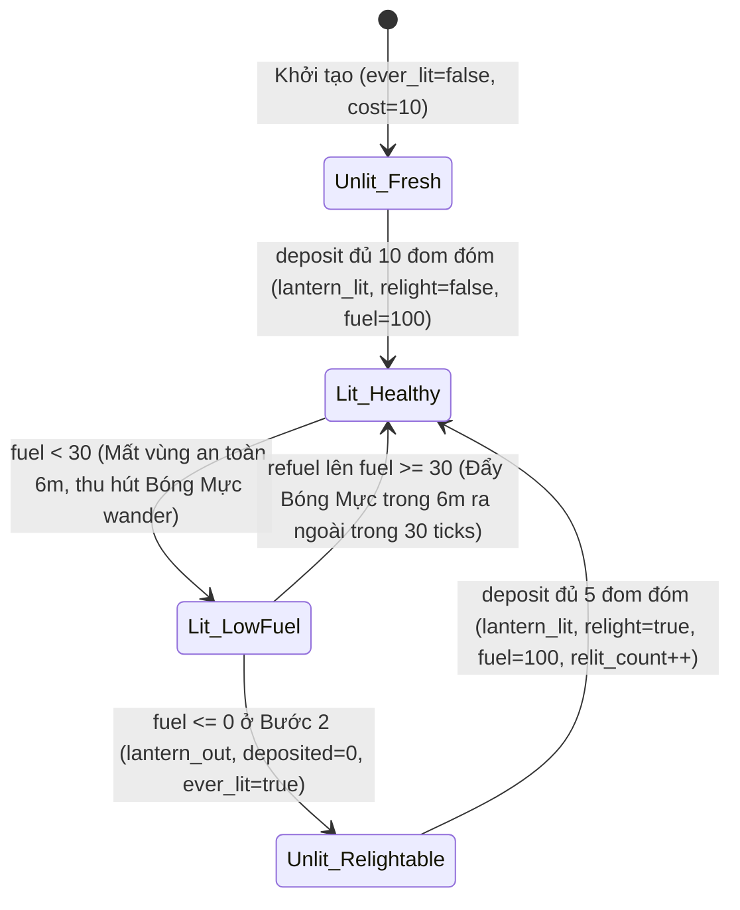

# ADR-001: Chuyển Đổi Mô Hình Nhiên Liệu Đèn Lồng, Bóng Mực Hút Dầu & Luật Thắng Sống Sót Tới Bình Minh (Phase 3 / TICKET-03)

- **Trạng thái:** Đã chấp thuận & Triển khai (Phase 3 — Tag `phase-3`)
- **Phiên bản Hợp đồng:** `Test Contract v1.2`
- **Ngày:** 2026-11-20

---

## 1. Bối cảnh & Vấn đề (Context)

Ở Phase 1 (`v1.0`) và Phase 2 (`v1.1`), một chiếc Đèn Lồng Lớn sau khi được nạp đủ đom đóm sẽ sáng vĩnh viễn (`lit = true`), tạo vùng an toàn cố định không bao giờ tắt, và trò chơi kết thúc thắng ngay lập tức (`reason: "all_lit"`) ở tick thắp sáng chiếc đèn cuối cùng.

Qua playtest thực tế, người chơi có kỹ năng tốt có thể thắp đủ đèn chỉ trong ~2 phút đầu, làm mất sự kịch tính ở nửa cuối Đêm. **TICKET-03 ("Đèn cạn dầu")** đưa ra Change Request thay đổi 3 luật cốt lõi:
1. **[THAY THẾ] Đèn đã sáng vẫn hao dầu (`1.0 fuel/s`), có thể châm thêm dầu (`refuel`), hết dầu sẽ tắt (`lantern_out`), và khi thắp lại chỉ tốn `5` đom đóm (`ever_lit = true`).**
2. **[THAY THẾ] Đèn có `fuel < 30` mất vùng an toàn `6m`, và Bóng Mực ở trạng thái `wander` sẽ tìm tới đèn yếu (`fuel < 30`) để hút dầu (`state = "drain"`, `5.0 fuel/s`).**
3. **[THAY THẾ] Bỏ thắng sớm (`all_lit`); chuyển sang mục tiêu sống sót tới hết giờ (`dawn_survived`) với số đèn đang sáng tại tick bình minh `>= ceil(0.6 * total_lanterns)` (`3/5`, `4/6`, `5/7`).**

---

## 2. Quyết định Thiết kế (Architecture & Design Decisions)

### 2.1. Biểu diễn Nhiên Liệu bằng Đơn Vị Nguyên `1/60` (`fuelUnits`)
- **Vấn đề:** Ở tần số 60 tick/giây, mỗi tick đèn tự hao `1/60` fuel và mỗi Bóng Mực đang `drain` hút `5/60` fuel. Nếu cộng/trừ số thực dấu phẩy động (`float`) qua 18.000 ticks sẽ tích lũy sai số IEEE-754 (ví dụ `29.999999999999996` thay vì `30.0`), làm sai lệch ngưỡng mất vùng an toàn (`fuel < 30`) và số đom đóm cần châm (`ceil((100 - fuel) / 10)`).
- **Quyết định:** Lưu trữ nhiên liệu nội bộ bằng số nguyên **`fuelUnits`** với quy ước **`1 fuel = 60 fuelUnits`** (`fuel_max = 100` tương ứng `6000 fuelUnits`, ngưỡng `low_fuel_threshold = 30` tương ứng đúng `1800 fuelUnits`):
  - Hao tự nhiên mỗi tick: `-1 fuelUnit`.
  - Mỗi Bóng Mực `drain` mỗi tick: `-5 fuelUnits`.
  - Mỗi đom đóm châm dầu (`+10 fuel`): `+600 fuelUnits` (giới hạn ở `6000`).
  - Số đom đóm cần châm: `Math.ceil((6000 - fuelUnits) / 600)`.
  - Chỉ khi xuất ra snapshot/event mới chuyển về số thực 1 chữ số thập phân: `round1(fuelUnits / 60)`.

### 2.2. Máy Trạng Thái Mở Rộng của Đèn Lồng (`Lantern State Machine`)
Mỗi đèn lồng `L_i` nay gồm các thuộc tính:
- `lit: boolean`
- `fuelUnits: integer` (`0 .. 6000`)
- `deposited: integer` (tiến độ nạp khi đang tắt)
- `ever_lit: boolean` (đánh dấu đèn đã từng sáng ít nhất 1 lần)
- `relit_count: integer` (số lần được thắp lại sau khi tắt)

### 2.3. Máy Trạng Thái Bóng Mực Mở Rộng (`drain` State)
- Ở trạng thái `wander`:
  - Nếu có đèn đang sáng yếu (`lit && fuelUnits < 1800`), chọn đèn yếu gần nhất (bằng nhau chọn `id` nhỏ hơn) làm mục tiêu `targetLanternId` và di chuyển tới đó. Khi `distXZ <= 2.0m`, chuyển sang `state = "drain"`.
  - Nếu không có đèn yếu: nếu Mây trong `<= 12m` thì sang `chase`; nếu Mây ở xa `> 12m` thì đi về đèn tắt gần nhất.
- Ở trạng thái `drain`:
  - Đứng yên hút `5 fuelUnits/tick` ở Bước 2; mỗi `60` ticks đang hút phát sự kiện `fuel_drain {lantern_id, shade_id, fuel}`.
  - Chuyển sang `chase` nếu Mây vào `<= 6.0m`; sang `stunned` nếu trúng Tỏa Sáng (cộng `+15` điểm thay vì `+5`); sang `wander` nếu đèn tắt (`fuelUnits <= 0`), đèn được châm dầu lên `>= 30` (`fuelUnits >= 1800`), hoặc khoảng cách tới đèn `> 2.0m`.
- Khi hết thời gian `stunned`: luôn trở về `wander`.

### 2.4. Thay Đổi Luật Thắng/Thua tại Bước 11 & Sức Chứa Tăng Dần
- **Sức chứa động (`capacity`):** Khởi đầu mỗi Đêm `capacity = 10`. Mỗi lần sự kiện `lantern_lit` xảy ra trong gameplay (cả thắp mới lẫn thắp lại, không tính đèn đặt sẵn từ scenario), tăng `successful_lights += 1` và cập nhật `capacity = Math.min(20, 10 + 2 * successful_lights)`.
- **Bước 11 (Xét Thắng/Thua):**
  - Không còn kết thúc game khi `lanterns.every(l => l.lit)`.
  - Thứ tự ưu tiên ở cuối mỗi tick (kể cả tick cuối cùng khi `time_left_s == 0`):
    1. `player.flames <= 0` -> `state = "lost"`, `game_over {result: "lost", reason: "no_flames"}`.
    2. `time_left_s <= 0`:
       - Nếu `count(l.lit) >= Math.ceil(0.6 * lanterns.length)`: `state = "won"`, cộng thưởng bình minh `sum(50 + Math.floor(l.fuel)) + flames * 50`, phát `game_over {result: "won", reason: "dawn_survived"}`.
       - Ngược lại: `state = "lost"`, phát `game_over {result: "lost", reason: "dawn"}`.

---

## 3. Hệ quả & Cập nhật Kiểm thử (Consequences)

- Các test cũ ở Phase 1–2 giả định "thắp đủ 5 đèn thì thắng ngay tại tick đó với `reason: all_lit`" không còn đúng theo luật mới và đã được cập nhật trong `tests/contract.test.js` (ghi rõ lý do thay thế sang kiểm thử `dawn_survived` và `refuel`/`lantern_out`).
- Toàn bộ thay đổi phá vỡ tương thích được ghi nhận chi tiết trong [CHANGELOG.md](../../CHANGELOG.md).
